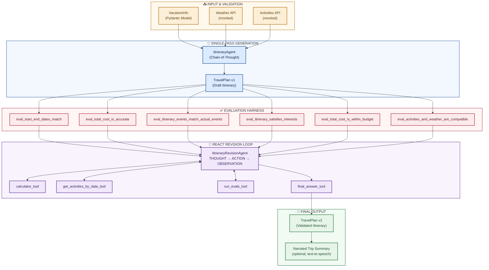

# AgentsVille Trip Planner

**A multi-stage agentic AI system for constraint-aware travel itinerary planning, built on OpenAI's GPT-4.1, Pydantic, and the ReAct (Reasoning + Acting) pattern.**

[](https://www.python.org/)
[](https://openai.com/index/gpt-4-1/)
[](https://docs.pydantic.dev/latest/)
[](https://arxiv.org/abs/2210.03629)
[]()
[]()

---

## Table of Contents

- [Overview](#overview)
- [Key Features](#key-features)
- [Architecture](#architecture)
- [Project Structure](#project-structure)
- [Tech Stack](#tech-stack)
- [Getting Started](#getting-started)
- [The Agents](#the-agents)
- [Tools](#tools)
- [Evaluation Harness](#evaluation-harness)
- [Data Models](#data-models)
- [Example Run](#example-run)
- [Known Limitations](#known-limitations)
- [References](#references)
- [License](#license)

---

## Overview

The AgentsVille Trip Planner automates one of the more tedious parts of travel planning: turning a set of traveler preferences, a fixed budget, and day-by-day weather and activity data into a validated, budget-aware itinerary that can be revised in response to natural-language feedback.

It combines three techniques that are now foundational to production agentic systems:

1. **Structured data validation** with Pydantic at every boundary in the pipeline
2. **Single-pass chain-of-thought (CoT) generation** for a strong first-draft itinerary
3. **A ReAct-style (Reasoning + Acting) revision loop** that autonomously repairs any itinerary that fails an explicit, code-enforced evaluation check

No itinerary is ever accepted on the strength of a model's own claim that it is correct. A shared, six-function evaluation harness (seven once traveler feedback is introduced) sits outside the language model and is the only thing that gets to say "done."

> This README summarizes the full technical write-up in [`AgentsVille_Trip_Planner_Report.docx`](./AgentsVille_Trip_Planner_Report.docx), which includes the complete problem statement, prompt design rationale, and results from a real, successful end-to-end run.

---

## Key Features

- **Chain-of-thought itinerary generation** — a single-pass agent reasons step by step through weather safety, interest matching, day coverage, and running budget tracking before emitting a validated `TravelPlan`.
-  **Self-correcting ReAct revision loop** — a second agent autonomously diagnoses and repairs constraint violations using four narrowly-scoped tools, without ever regenerating the itinerary from scratch.
-  **Independent, code-enforced evaluation harness** — six deterministic checks (plus one LLM-judged weather-compatibility check) that cannot be talked out of failing a genuinely broken itinerary.
-  **Fully typed data contracts** — every object that crosses a boundary (input, agent output, tool call) is a Pydantic `BaseModel`, and the `TravelPlan` JSON Schema is injected directly into both agents' system prompts.
-  **Optional narrated trip summary** — a fun capstone step that narrates the finished itinerary aloud via text-to-speech.
-  **Fully traceable reasoning** — every THOUGHT, ACTION, and OBSERVATION in the revision loop is retained in the conversation history for auditability.

---

## Architecture

The system is a five-stage pipeline that moves a travel request from raw structured input to a validated, revisable itinerary. The evaluation harness is a single shared artifact reused across three of those stages, which guarantees that "passing" means the same thing everywhere in the pipeline.



### Stage-by-stage

| Stage | What happens |
|---|---|
| **1. Input & Validation** | A plain dict describing travelers, destination, dates, and budget is validated into a `VacationInfo` Pydantic model. Mocked weather and activities APIs are queried for every date of the trip. |
| **2. Single-Pass Generation** | `ItineraryAgent` (GPT-4.1) receives the full task description, output format, and complete weather/activities context in one system prompt, and returns a draft `TravelPlan` after a single chat completion call. |
| **3. Evaluation Harness** | Six independent, mostly-deterministic checks run against the draft and produce a structured `{success, failures}` result. |
| **4. ReAct Revision Loop** | If any check fails (or traveler feedback hasn't been incorporated), `ItineraryRevisionAgent` alternates THOUGHT → ACTION → OBSERVATION turns, calling tools to diagnose and repair the itinerary, until the evaluation harness reports a clean pass. |
| **5. Final Output** | The validated `TravelPlan` is presented day-by-day, and optionally narrated aloud as a fun capstone step. |

---

## Project Structure

```
agentsville-trip-planner/
├── activity_starter.ipynb          # Starter notebook with TODO sections
├── activity_completed.ipynb        # Completed notebook (all TODOs filled in)
├── project_lib.py                  # Helper functions, mocked APIs, ChatAgent base class
├── activity_instructions.docx      # Original assignment brief and grading rubric
├── AgentsVille_Trip_Planner_Report.docx   # Full technical report
└── README.md                       # You are here
```

---

## Tech Stack

| Category | Technology |
|---|---|
| Language model | OpenAI GPT-4.1 (chat completions API) |
| Data validation | Pydantic v2 |
| Data wrangling | pandas |
| Safe arithmetic | numexpr |
| JSON repair | json_repair |
| Notebook environment | Jupyter |
| Optional narration | OpenAI text-to-speech |

---

## Getting Started

### Prerequisites

- Python 3.10+
- An OpenAI API key with access to the GPT-4.1 model family

### Installation

```bash
python3 -m venv .venv
source .venv/bin/activate        # Windows: .venv\Scripts\activate

pip install json-repair numexpr openai pandas pydantic python-dotenv jupyter
```

### Configuration

Set your API key as an environment variable (preferred over hardcoding it in the notebook):

```bash
export OPENAI_API_KEY=sk-...      # macOS/Linux
set OPENAI_API_KEY=sk-...         # Windows
```

### Run

```bash
jupyter notebook activity_completed.ipynb
```

Run all cells top to bottom. The notebook will:

1. Validate the traveler and vacation data
2. Generate a draft itinerary
3. Evaluate it against six constraints
4. Collect traveler feedback and run the ReAct revision loop
5. Present the final, validated itinerary

---

## The Agents

### `ItineraryAgent`

A single-pass, chain-of-thought agent. It is never called more than once per itinerary attempt and has no access to tools. Its system prompt embeds the full `VacationInfo`, weather forecast, and activities calendar directly as context, and requires the model to reason through an explicit `ANALYSIS` section before producing a `FINAL OUTPUT` JSON block that validates against the `TravelPlan` schema.

### `ItineraryRevisionAgent`

Implements the **ReAct** pattern (Yao et al., 2023). At every turn it must emit exactly one `THOUGHT` followed by exactly one `ACTION`, formatted as a JSON tool call:

```json
{"tool_name": "[tool_name]", "arguments": {"arg1": "value1"}}
```

The surrounding Python code parses the call (with a JSON-repair fallback), executes it, and appends the result as an `OBSERVATION`. The loop repeats until the model calls `final_answer_tool`, which is only permitted immediately after a `run_evals_tool` call reports a completely empty `failures` list.

---

## Tools

| Tool | Purpose | Key Input(s) | Returns |
|---|---|---|---|
| `calculator_tool` | Evaluate an exact mathematical expression using `numexpr` (safe, non-`eval`-based). | `input_expression (str)` | `float` |
| `get_activities_by_date_tool` | Retrieve all legitimate activities for a given date and city. | `date (str)`, `city (str)` | `List[dict]` (Activity records) |
| `run_evals_tool` | Re-run all evaluation functions against a candidate `TravelPlan`. | `travel_plan (TravelPlan)` | `{success: bool, failures: list}` |
| `final_answer_tool` | Signal loop completion and return the final, validated `TravelPlan`. | `final_output (TravelPlan)` | `TravelPlan` |

---

## Evaluation Harness

| Evaluation Function | Constraint Checked |
|---|---|
| `eval_start_end_dates_match` | Itinerary start/end dates match `VacationInfo` arrival/departure dates. |
| `eval_total_cost_is_accurate` | Stated `total_cost` equals the exact sum of every scheduled activity's price. |
| `eval_itinerary_events_match_actual_events` | Every activity matches an activity in the source calendar exactly (not hallucinated). |
| `eval_itinerary_satisfies_interests` | Each traveler has at least one activity matching one of their stated interests. |
| `eval_total_cost_is_within_budget` | Stated `total_cost` does not exceed the vacation budget. |
| `eval_activities_and_weather_are_compatible` | No outdoor-only activity is scheduled during rainy/thunderstorm conditions (LLM-judged). |
| `eval_traveler_feedback_is_incorporated` | The revised itinerary reflects the traveler's follow-up feedback (added once feedback is collected). |

---

## Data Models

| Model | Key Fields | Role |
|---|---|---|
| `Traveler` | `name`, `age`, `interests` | One person within `VacationInfo` |
| `VacationInfo` | `travelers`, `destination`, `date_of_arrival`, `date_of_departure`, `budget` | Root input type |
| `Weather` | `temperature`, `temperature_unit`, `condition` | One day's forecast |
| `Activity` | `activity_id`, `name`, `start_time`, `end_time`, `location`, `description`, `price`, `related_interests` | One bookable event |
| `ActivityRecommendation` | `activity`, `reasons_for_recommendation` | An `Activity` plus rationale |
| `ItineraryDay` | `date`, `weather`, `activity_recommendations` | One day of the itinerary |
| `TravelPlan` | `city`, `start_date`, `end_date`, `total_cost`, `itinerary_days` | Root output type |

---

## Example Run

Results below are from an actual successful run against the live GPT-4.1 API (not simulated), for the default scenario: travelers Yuri and Hiro, budget 130, destination AgentsVille, 2025-06-10 to 2025-06-12.

| Date | Weather | Activities | Daily Cost |
|---|---|---|---|
| 2025-06-10 | Clear, 31°C | FutureTech Breakfast Meet-Up; Serve & Savor: Tennis and Taste Luncheon; AgentsVille Twilight Writing Escape | $55 |
| 2025-06-11 | Partly Cloudy, 34°C | Tech Lunch & Learn: AI Frontiers; Palette & Palate: Art Meets Cooking Experience | $45 |
| 2025-06-12 | Thunderstorm, 28°C | Soundtrack Picnic: Lunchtime Movies & Melodies (indoor rain backup); Tech & Film Fusion Night | $30 |
| **Total** | | **6 activities** | **$130 of $130 budget** |

The draft itinerary passed all six core evaluation functions on the first attempt. The `ItineraryRevisionAgent` confirmed traveler feedback was already satisfied in a single `run_evals_tool` call and called `final_answer_tool` immediately, converging in **2 total agent turns** with zero repair tool calls needed.

---

## Known Limitations

- **Stochastic convergence**: even with a heavily hardened system prompt, GPT-4.1 has been observed, in earlier development runs, to call `final_answer_tool` prematurely despite an unresolved constraint violation. The evaluation harness, not the prompt, is the actual correctness guarantee.
- **Mocked data layer**: weather and activities data are synthetic and scoped to a single fictional destination and a narrow date range.
- **LLM-judged weather check**: `eval_activities_and_weather_are_compatible` relies on an LLM call and has shown run-to-run variance on ambiguous activity descriptions.
- **No subjective quality checks**: the harness does not evaluate activity ordering, travel time between locations, or overall itinerary "enjoyability."
- **Cost and latency scale with loop iterations**: a run that needs many repair turns is slower and more expensive than a clean first-pass convergence.

See the full [technical report](./AgentsVille_Trip_Planner_Report.pdf) for a detailed discussion.

---

## References

1. Yao, S., Zhao, J., Yu, D., Du, N., Shafran, I., Narasimhan, K., & Cao, Y. (2023). *ReAct: Synergizing Reasoning and Acting in Language Models.* [arXiv:2210.03629](https://arxiv.org/abs/2210.03629)
2. Wei, J., Wang, X., Schuurmans, D., Bosma, M., Ichter, B., Xia, F., Chi, E., Le, Q., & Zhou, D. (2022). *Chain-of-Thought Prompting Elicits Reasoning in Large Language Models.* [arXiv:2201.11903](https://arxiv.org/abs/2201.11903)
3. OpenAI. (2025). *Introducing GPT-4.1 in the API.* [openai.com/index/gpt-4-1](https://openai.com/index/gpt-4-1/)
4. OpenAI. *GPT-4.1 Prompting Guide.* [OpenAI Cookbook](https://github.com/openai/openai-cookbook/blob/main/examples/gpt4-1_prompting_guide.ipynb)
5. OpenAI. *Function Calling.* [OpenAI API Documentation](https://developers.openai.com/api/docs/guides/function-calling)
6. Pydantic. *Validation Documentation (v2).* [docs.pydantic.dev](https://docs.pydantic.dev/latest/)

---

## License

This project is provided for educational purposes. Add your preferred license (e.g., MIT) here before distributing.
